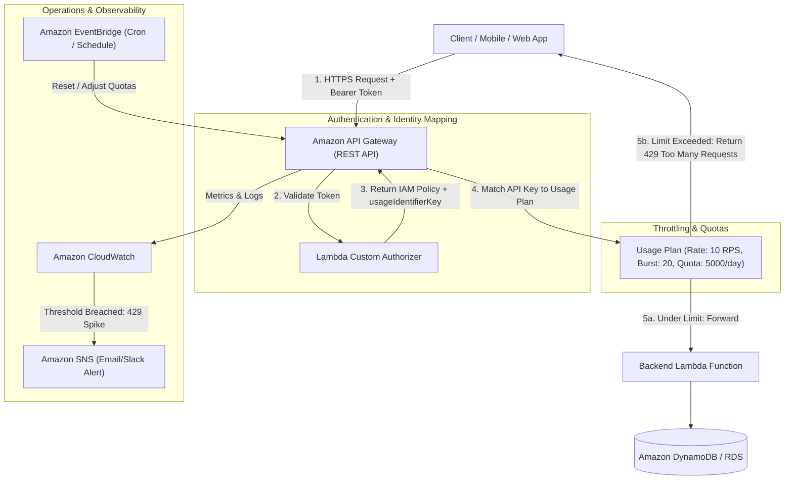

# AWS API Rate Limiting & Throttling Architecture Workshop

[](https://gohugo.io/)
[](https://aws.amazon.com/api-gateway/)
[](https://aws.amazon.com/lambda/)
[](https://aws.amazon.com/cloudwatch/)
[](https://aws.amazon.com/eventbridge/)
[](https://opensource.org/licenses/MIT)

> **Live Workshop Documentation:** [https://pvg341.github.io/API-RateLimit-Workshop/](https://pvg341.github.io/API-RateLimit-Workshop/)  
> **Author:** Hồ Sỹ Phúc ([@PVG341](https://github.com/PVG341))

A comprehensive, hands-on architectural workshop demonstrating multi-tier **Rate Limiting**, **Burst Throttling**, and **Usage Quota Management** on Amazon Web Services (AWS). This guide walks you through building production-ready, DDoS-resilient API infrastructure using Amazon API Gateway, AWS Lambda Authorizers, Amazon EventBridge, and Amazon CloudWatch.

---

## 📑 Table of Contents

- [Overview & Objectives](#-overview--objectives)
- [System Architecture](#-system-architecture)
- [Workshop Modules](#-workshop-modules)
- [Core Engineering Concepts](#-core-engineering-concepts)
- [Prerequisites](#-prerequisites)
- [Local Development & Preview](#-local-development--preview)
- [Deployment](#-deployment)
- [Clean-Up Guide](#-clean-up-guide)
- [Contributing & License](#-contributing--license)

---

## 🎯 Overview & Objectives

In modern distributed systems, unguarded APIs are prone to traffic spikes, noisy neighbor problems, aggressive scraping, and distributed denial-of-service (DDoS) attacks. Implementing granular rate limits and quota enforcement protects backend services from exhaustion and controls cloud infrastructure costs.

### What You Will Learn
1. **Tiered Throttling:** Configure token bucket rate limits (steady-state RPS) and burst limits at the API Gateway layer.
2. **Usage Plans & API Keys:** Bind client identities to distinct operational tiers (e.g., Free, Silver, Gold).
3. **Dynamic Lambda Authorizers:** Authenticate bearer tokens and dynamically attach client usage identifiers (`usageIdentifierKey`) to avoid distributing raw API keys to clients.
4. **Scheduled Quota Resets:** Automate tier quota recalibration and resets with EventBridge rules.
5. **Observability & Alerts:** Monitor `429 Too Many Requests` breaches via CloudWatch Metrics and trigger automated notifications.
6. **Documentation Delivery:** Package and host documentation statically using Hugo and Amazon S3.

---

## 🏛️ System Architecture



---

## 📚 Workshop Modules

| Module | Title | Summary & Hands-On Deliverables |
| :--- | :--- | :--- |
| **01** | [Introduction](https://pvg341.github.io/API-RateLimit-Workshop/1-introduction/) | Core concepts of rate limiting vs. throttling, Token Bucket algorithm, and defense-in-depth API security. |
| **02** | [Preparation Steps](https://pvg341.github.io/API-RateLimit-Workshop/2-preparation-steps/) | Set up AWS IAM execution roles, configure security boundaries, and bootstrap initial Lambda functions. |
| **03** | [API Gateway, Usage Plans & API Keys](https://pvg341.github.io/API-RateLimit-Workshop/3-create-api-usage-plan-api-key/) | Create REST API endpoints, define Usage Plans with Rate/Burst quotas, and generate client API Keys. |
| **04** | [Custom Lambda Authorizer](https://pvg341.github.io/API-RateLimit-Workshop/4-create_authorizer/) | Implement a `TOKEN` type authorizer that decodes JWTs, verifies permissions, and maps caller identity to an API key. |
| **05** | [EventBridge Scheduler](https://pvg341.github.io/API-RateLimit-Workshop/5-create-eventbridge-schedule/) | Configure Amazon EventBridge recurring cron rules to adjust API quotas or trigger automated administrative jobs. |
| **06** | [CloudWatch Alarms & Monitoring](https://pvg341.github.io/API-RateLimit-Workshop/6-create-cloudwatch-alarm/) | Track API Gateway `4XXError` and `ClientError` metrics, creating CloudWatch alarms for sustained 429 surges. |
| **07** | [Static Hosting with S3](https://pvg341.github.io/API-RateLimit-Workshop/7-hosting-static-web-with-s3/) | Build and deploy static workshop documentation and client testing dashboards to Amazon S3 with website hosting. |
| **08** | [Clean-Up](https://pvg341.github.io/API-RateLimit-Workshop/8-clean-up/) | Safely delete provisioned resources (API Gateway, Lambdas, CloudWatch Alarms, S3 Buckets) to prevent unexpected charges. |

---

## 💡 Core Engineering Concepts

### 1. Token Bucket vs. Leaky Bucket
AWS API Gateway implements the **Token Bucket** algorithm:
- **Rate (tokens/second):** The steady-state rate at which tokens are added to the bucket (e.g., 100 requests/sec).
- **Burst (bucket capacity):** The maximum number of concurrent requests the bucket can hold without dropping (e.g., 200 requests).
- When a burst depletes all available tokens, API Gateway immediately responds with HTTP `429 Too Many Requests` without touching backend compute resources.

### 2. Decoupled Key Management with Lambda Authorizers
Rather than distributing brittle API keys to untrusted frontend clients, the architecture leverages custom **Lambda Token Authorizers**:
```javascript
// Dynamic usage identifier attachment
const authResponse = {
  principalId: decoded.sub,
  policyDocument: {
    Version: '2012-10-17',
    Statement: [
      {
        Action: 'execute-api:Invoke',
        Effect: 'Allow',
        Resource: event.methodArn,
      },
    ],
  },
  usageIdentifierKey: userApiKey, // Binds caller to specific API Gateway Usage Plan
};
```

---

## 🛠️ Prerequisites

- An active **AWS Account** with administrative permissions for IAM, API Gateway, Lambda, CloudWatch, và S3.
- **AWS CLI v2** installed and configured (`aws configure`).
- **Node.js** (>= 18.x) or **Python** (>= 3.10) for Lambda function runtimes.
- **Hugo** (Extended version >= 0.110.0) for local documentation generation.
- **cURL**, **Postman**, or **k6** for load testing and rate-limit verification.

---

## 💻 Local Development & Preview

The workshop documentation is generated with [Hugo](https://gohugo.io/) using the [`hugo-theme-learn`](https://github.com/matcornic/hugo-theme-learn) theme.

1. **Clone the repository:**
   ```bash
   git clone https://github.com/PVG341/API-RateLimit-Workshop.git
   cd API-RateLimit-Workshop
   ```

2. **Initialize Submodules (theme dependency):**
   ```bash
   git submodule update --init --recursive
   ```

3. **Start Hugo local development server:**
   ```bash
   hugo server -D
   ```

4. **View documentation:**
   Open your browser at `http://localhost:1313/API-RateLimit-Workshop/`.

---

## 🚀 Deployment

### Deploying Documentation to GitHub Pages
To build static HTML assets into the `public/` directory:
```bash
hugo --minify
```
Push the contents of the generated `public/` folder to the `gh-pages` branch or configure a GitHub Actions workflow to publish automatically on pushes to `main`.

### Deploying Documentation to Amazon S3
```bash
aws s3 sync ./public s3://<your-workshop-bucket-name> --delete --acl public-read
```

---

## 🧹 Clean-Up Guide

To avoid incurring recurring AWS infrastructure charges, follow [Module 8](https://pvg341.github.io/API-RateLimit-Workshop/8-clean-up/) to remove all workshop resources:
1. Delete API Gateway REST APIs and associated Usage Plans / API Keys.
2. Delete Lambda Functions and CloudWatch Log Groups.
3. Remove CloudWatch Alarms and SNS Subscriptions.
4. Empty and delete Amazon S3 static hosting buckets.
5. Delete custom IAM Execution Roles.

---

## 👤 Author

**Hồ Sỹ Phúc**  
- **GitHub:** [@PVG341](https://github.com/PVG341)  
- **Portfolio:** [Interactive Backend Portfolio](https://hosyphuc246-portfolio.vercel.app/)  
- **Email:** [phuc.2274802010675@vanlanguni.vn](mailto:phuc.2274802010675@vanlanguni.vn)

---

## 📄 License

This workshop is distributed under the [MIT License](LICENSE). Feel free to adapt and use it for internal training, academic workshops, or cloud architecture showcases.
